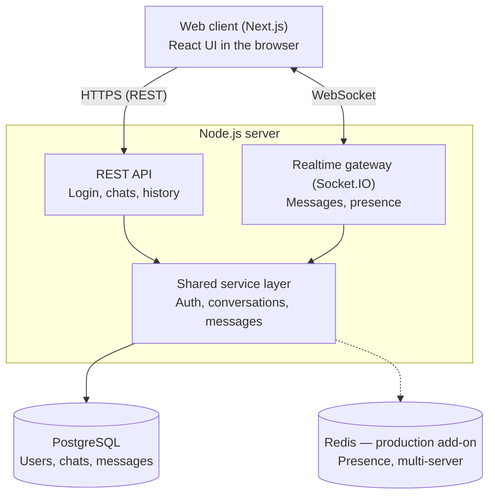
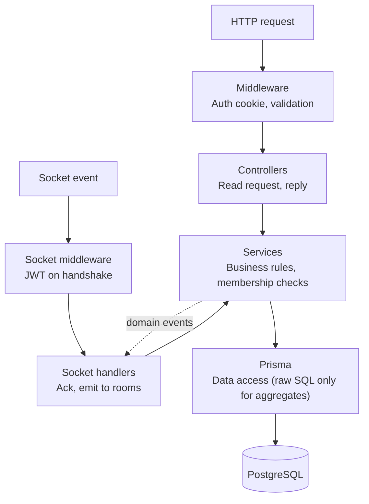
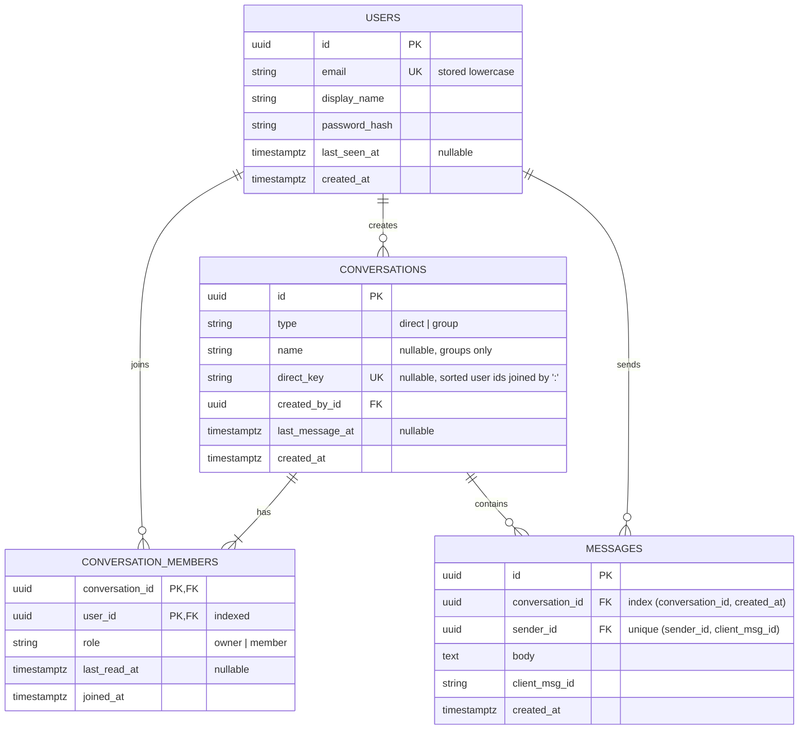
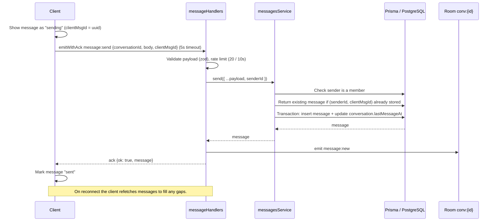
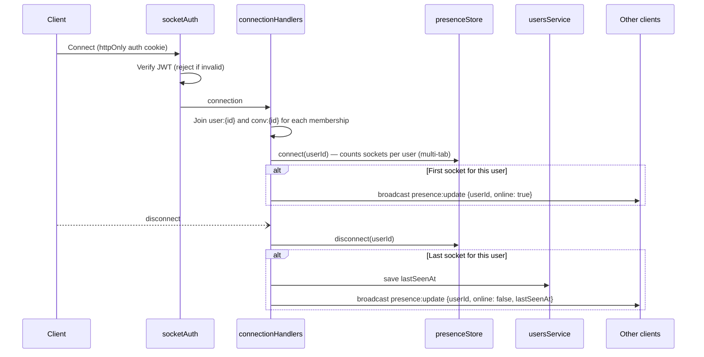

# Architecture

Enterprise chat: authentication, real-time 1:1 and group messaging, history, presence.
Design rationale lives in [DECISIONS.md](./DECISIONS.md).

## High-level design

- REST and the WebSocket gateway share the **same services**, so business rules live in one place.
- The prototype keeps presence in memory on a single server. Redis is the scale-out path (Socket.IO adapter + shared presence).

## Low-level design (layers)

| Layer | Responsibility | Must not |
|---|---|---|
| Routes / middleware | Wire endpoints, authenticate, validate input (zod) | Contain business logic |
| Controllers / socket handlers | Read input, call one service function, reply | Touch Prisma |
| Services | Business rules, permission checks, Prisma queries, throw `AppError` | Know about HTTP or Socket.IO |
| Prisma | Data access: there is no separate repository layer | — |

Services announce side effects (e.g. "conversation created") on an in-process `EventEmitter`; the realtime layer subscribes and pushes to sockets.

## Data model

- `direct_key` UNIQUE: a pair of users can only ever have one DM.
- `(sender_id, client_msg_id)` UNIQUE: retried sends are idempotent.
- `(conversation_id, created_at)` index: serves history pagination and "latest message" lookups.
- Deleting a conversation cascades to its members and messages.

## Send message

## Connect + presence

## REST API

Base path `/api`. Auth is the `cic_session` httpOnly cookie (JWT `{ sub }`, 8h). Every input is validated with zod.
Errors are always `{ error: { code, message } }`.

| Method | Path | Auth | Input | Success | Errors |
|---|---|---|---|---|---|
| POST | `/auth/register` | — | `{ email, displayName, password (8–72) }` | 201 `{ user }` + cookie | 400, 409 `EMAIL_TAKEN` |
| POST | `/auth/login` | — | `{ email, password }` · 5/min per IP | 200 `{ user }` + cookie | 400, 401 `INVALID_CREDENTIALS`, 429 |
| POST | `/auth/logout` | — | — | 204, clears cookie | — |
| GET | `/auth/me` | ✓ | — | `{ user }` | 401 |
| GET | `/users` | ✓ | `?search=` | `{ users: [User + isOnline] }` (excludes self, max 50) | 401 |
| GET | `/conversations` | ✓ | — | `{ conversations: [Conversation] }` by `lastMessageAt` desc | 401 |
| POST | `/conversations/direct` | ✓ | `{ userId }` | 200 `{ conversation }` (find-or-create) | 400, 401 |
| POST | `/conversations/group` | ✓ | `{ name, memberIds (≥2 others) }` | 201 `{ conversation }`; creator is `owner` | 400, 401 |
| POST | `/conversations/:id/read` | member | — | 204 (sets `lastReadAt` = now) | 400, 401, 403 |
| GET | `/conversations/:id/messages` | member | `?cursor=<message id>&limit=1–100 (30)` | `{ items: [Message] newest first, nextCursor \| null }` | 400, 401, 403 |

- `User`: `{ id, email, displayName, lastSeenAt }` (from `toPublicUser`, never `passwordHash`)
- `Conversation`: `{ id, type, name, createdAt, lastMessageAt, lastMessage: Message | null, unreadCount, members: [User + { role, isOnline }] }`
- `Message`: `{ id, conversationId, senderId, body, clientMsgId, createdAt }`
- The cursor is the id of the oldest message already loaded (Prisma `cursor` + `skip: 1`, ordered by `createdAt`, `id`). Pass `nextCursor` back to get older messages; it is `null` once a page comes back short.

## Socket events

The handshake is authenticated with the same cookie. On connect the socket joins `user:{id}` plus `conv:{id}` for each of the user's conversations.
Client events use an ack: `{ ok: true, ... }` or `{ ok: false, error: { code, message } }`. Handlers never throw.

| Event | Direction | Payload | Notes |
|---|---|---|---|
| `message:send` | client → server (ack) | `{ conversationId, body, clientMsgId }` | Member only; body trimmed 1–4000; 20 per 10s per user; idempotent per `clientMsgId`. Ack `{ ok, message }` |
| `message:new` | server → `conv:{id}` (sender included) | `Message` | Clients dedupe by `id` / `clientMsgId` |
| `conversation:new` | server → each member's `user:{id}` | `Conversation` | Members' live sockets are joined to `conv:{id}` first |
| `presence:update` | server → everyone | `{ userId, isOnline, lastSeenAt }` | Sent on the first socket connecting / last socket disconnecting (multi-tab aware) |
