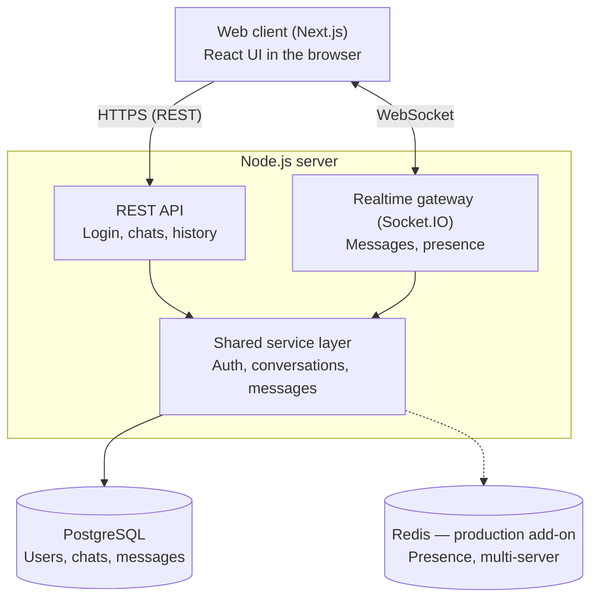
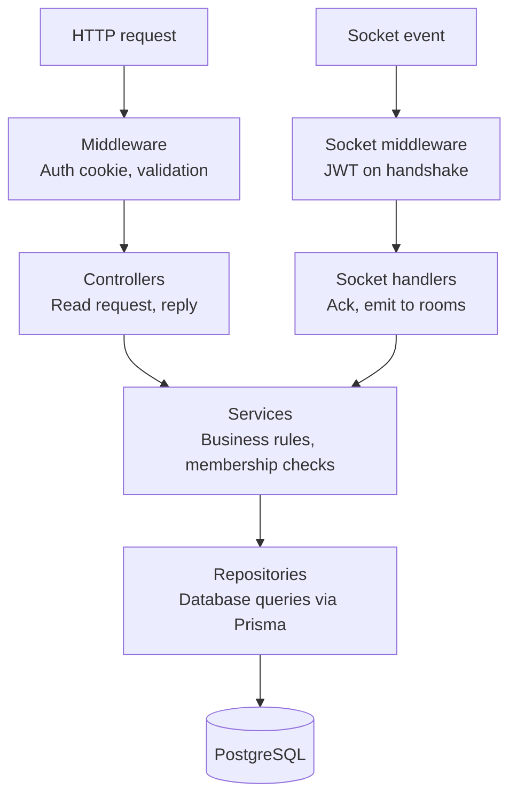
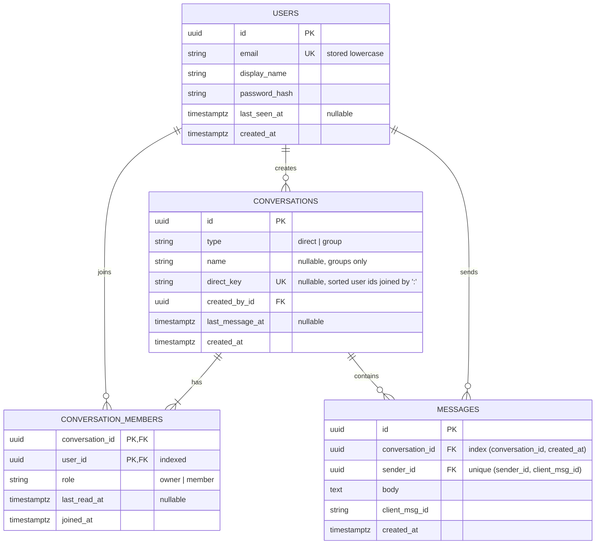
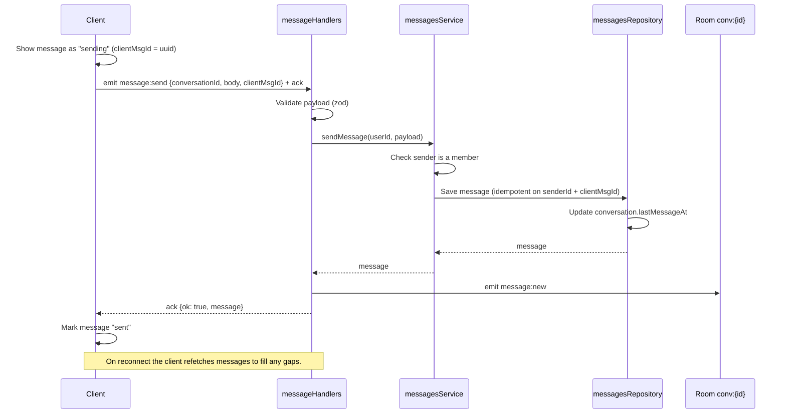
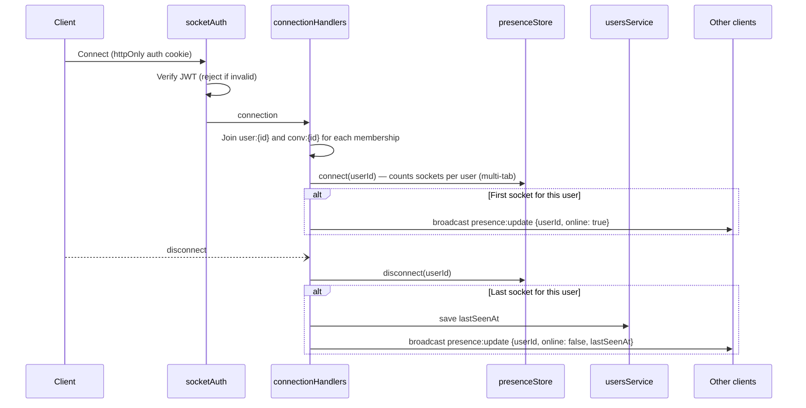

# Architecture

Enterprise chat: authentication, real-time 1:1 and group messaging, history, presence.
Design rationale lives in [DECISIONS.md](./DECISIONS.md).

## High-level design

- REST and the WebSocket gateway share the **same services**, so business rules live in one place.
- The prototype keeps presence in memory on a single server. Redis is the scale-out path (Socket.IO adapter + shared presence).

## Low-level design (layers)

| Layer | Responsibility | Must not |
|---|---|---|
| Routes / middleware | Wire endpoints, authenticate, validate input (zod) | Contain business logic |
| Controllers / socket handlers | Read input, call one service method, reply | Touch Prisma |
| Services | Business rules, permission checks, throw `AppError` | Know about HTTP or sockets |
| Repositories | Prisma queries | Make decisions |

## Data model

- `direct_key` UNIQUE: a pair of users can only ever have one DM.
- `(sender_id, client_msg_id)` UNIQUE: retried sends are idempotent.
- `(conversation_id, created_at)` index: serves history pagination and "latest message" lookups.
- Deleting a conversation cascades to its members and messages.

## Send message

## Connect + presence

## REST API

_To be filled in during the next phase._

## Socket events

_To be filled in during the next phase._
